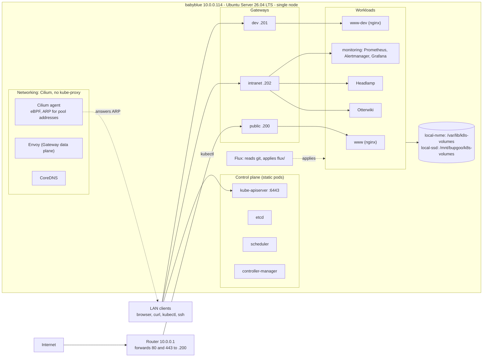

# Architecture

babyblue runs the whole cluster: the Kubernetes control plane, the networking, the storage and every workload. Other machines on the LAN (the router, the Pi-hole, theopolis) support it; see [[Network and hosts|paleotek kluster/network and hosts]].

## How traffic gets in

HTTP and HTTPS enter through a **Gateway** (Gateway API, implemented by Cilium and Envoy). There are three, each on its own address from a pool of 10.0.0.200 to 10.0.0.219:

| Gateway | Address | Reachable from | Serves |
|---|---|---|---|
| public | 10.0.0.200 | the internet (router forwards 80 and 443) | www.paleotek.net only |
| dev | 10.0.0.201 | LAN only | the dev copy of the site, plain http |
| intranet | 10.0.0.202 | LAN only | Grafana, Headlamp, the wiki, told apart by hostname |

Any non-HTTP protocol could use a plain `LoadBalancer` Service from the same pool. No cloud load balancer is needed: Cilium answers ARP for the pool addresses on the LAN, so the router and clients find them as if they were machines. (Gateways answer with the node's own MAC address.)

## What runs where

| Layer | What | How it is managed |
|---|---|---|
| Host | Ubuntu, containerd, kubelet, the backup timer, the etcd metrics relay | scripts, run by hand with sudo |
| Cluster core | kubeadm control plane, Cilium (first install), CoreDNS settings, StorageClasses | scripts |
| Everything else | cert-manager, issuers, Gateways, monitoring, Headlamp, Otterwiki, the nginx sites, metrics-server | Flux, from git |

The split follows one rule: what runs *in* the cluster moves to Flux, one app at a time; the host and day-0 bootstrap stay as scripts. See [[GitOps with Flux|paleotek kluster/gitops with flux]].

## Key decisions

| Decision | Why |
|---|---|
| kubeadm, not k3s or MicroK8s | Closest to a self-managed production cluster, and every component is visible |
| The node's hostname (`babyblue`) is the API endpoint | One node, and the API certificate already names it. An alias only matters for a load-balanced multi-node control plane. (An earlier alias, `nauplius`, was removed) |
| containerd 2.3 (LTS), systemd cgroup driver | The most common runtime; the LTS line supports Kubernetes 1.36; kubelet and runtime must share one cgroup manager |
| Kubernetes 1.36, one minor behind the latest | Prefer the mature line. Support runs until 2027-06-28 |
| Cilium instead of kube-proxy | eBPF service routing, Hubble visibility, and Gateway API support in one component |
| Helm for Cilium | Values live in the repo; the chart version is pinned |
| local-path-provisioner | The simplest storage that fits one node. Revisit when nodes are added |
| Gateway API, not Ingress | The community ingress-nginx controller was retired in March 2026 |
| Flux with SOPS | Deployments are commits; secrets live in git encrypted |

## Address ranges

| What | Range |
|---|---|
| LAN | 10.0.0.0/24 |
| Pods | 10.8.0.0/16 (Cilium gives each node a /24). Cilium's default, 10.0.0.0/8, would overlap the LAN |
| Services | 10.16.0.0/16 |
| LoadBalancer pool | 10.0.0.200 to 10.0.0.219, outside the router's DHCP range |
