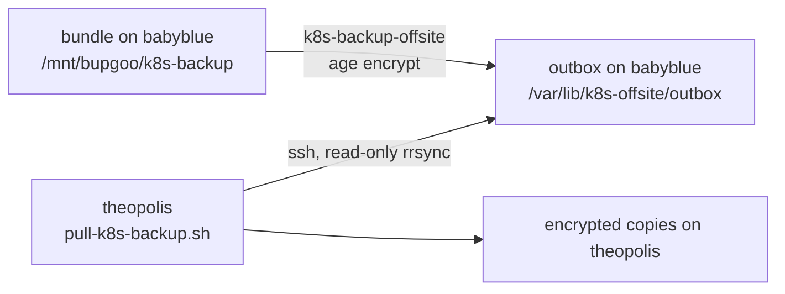

# Backups

## What is backed up, and when

A systemd timer runs `k8s-backup` on babyblue every night at **02:30 UTC** (babyblue's clock is UTC). It writes one bundle, `/mnt/bupgoo/k8s-backup/k8s-backup-<timestamp>.tar.gz`, with a `.sha256` file. The newest **7** are kept.

| In the bundle | Notes |
|---|---|
| An etcd snapshot | the whole state of the cluster, including every Secret and the CA and ACME account keys |
| Cluster config | `/etc/kubernetes`, kubelet and containerd config, `~/k8s-setup` |
| Volume data: Otterwiki, Grafana, Alertmanager | under `volumes/<namespace>/<pvc>/`. Files are copied as they are; every SQLite file goes through SQLite's own online-backup API (read-only, integrity-checked, refused if the database is in WAL mode), so a copy is never torn |

**Deliberately not backed up:** Prometheus (its history is not worth a torn copy of a live database) and the www volumes (the site lives in `WWW_CONTENT` on the workstation). Otterwiki's pages are also in the paleowiki repository on GitHub.

Safety rules of the job:
- It backs up only a **healthy** cluster (API `/readyz` and etcd health), and prunes old bundles only after a new one is verified, so an outage never pushes good backups out.
- A listed volume that does not exist is skipped with a note in `MANIFEST.txt`. A listed volume that *fails* stops the run: no new bundle, nothing pruned, and the failure alert fires.
- Bundles hold CA private keys and Secrets, so they are root-only and are **cluster-admin-equivalent secrets**. Never print, commit or copy them.
- The bundles on babyblue live on the same machine as the cluster; they do not protect against losing babyblue. That is what the off-site copy is for.

The job writes its own metrics (`k8s_backup_*`) for Prometheus, because Ubuntu's AppArmor stops node-exporter's systemd collector from reaching the host's D-Bus. Its `UMask=0077` means files it writes need an explicit `chmod`. See [[Monitoring and alerts|paleotek kluster/monitoring and alerts]].

Install with `sudo scripts/backup/install-backup-timer.sh` (it writes `/etc/k8s-backup.env`; re-run it after changing backup settings or updating the scripts), then `sudo systemctl start k8s-backup.service` and `journalctl -u k8s-backup`.

## Off-site copy (theopolis pulls)

After each backup, `k8s-backup-offsite` encrypts every new bundle with `age` to the public key in `AGE_RECIPIENT` and leaves the `.age` file (plus a `.sha256`) in `/var/lib/k8s-offsite/outbox`. That is the pull account's home on the root disk; it cannot traverse the second disk's mount point.

theopolis **pulls** that folder with `scripts/backup/theopolis/pull-k8s-backup.sh`. Its SSH key is tied to theopolis's own address (10.0.0.196) and may only run a read-only `rrsync` on the outbox, as the no-password account `k8s-offsite`. The pull verifies checksums and fails if the newest copy is older than 36 hours.

The consequence is deliberate: **babyblue holds no credentials for theopolis and no key that decrypts.** A compromised babyblue can neither delete the off-site copies nor read them. The age **private** key exists only in the password manager (a restore needs it: `age -d -i key.txt bundle.tar.gz.age > bundle.tar.gz`). It is a different key from the one SOPS uses for secrets in git.

The machine-off watcher on theopolis mails you if the newest pulled copy is older than 36 hours; nothing on babyblue sees whether the pull happened.

## Pi-hole settings

The Pi-hole holds the intranet records and every device depends on it, but its settings were in no backup. `scripts/pihole/install-pihole-backup.sh` (sudo, on the Pi-hole host) installs the same pattern:

- A nightly timer (03:00 UTC) runs `pihole-backup`: a Teleporter export (settings, local DNS records, adlists, groups, the web password hash and the query-history database; all of it stays inside the age encryption), encrypted with the same age **public** key into `/var/lib/dns-offsite/outbox`. RAM holds the plaintext during the run. 7 are kept.
- theopolis pulls it with the same pull script (`PATTERN='pihole-backup-*.age'`, its own key, host key and cron line; see that script's header) through the no-password account `dns-offsite`, limited by `authorized_keys` to a read-only `rrsync` from that one address.
- The Pi-hole holds no key that decrypts and no credential for theopolis.
- The watcher mails you if the newest pulled export is older than 36 hours.
- Restore: `age -d`, then `pihole-FTL --teleporter <file>` on a Pi-hole, or Settings, Teleporter.
- `scripts/backup/theopolis/pihole-restore-drill.sh <key> <export.age>` proves it works: it imports the newest pulled export into a throwaway Pi-hole container of the same version and checks that it answers the intranet name with 10.0.0.202.

## Restoring

See [[Restoring and drills|paleotek kluster/restoring and drills]]. A complete machine replacement is in [[Replacing the host|paleotek kluster/replacing the host]].
