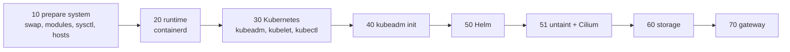

# Building the cluster

The scripts run on babyblue, copied to `~/k8s-setup/{scripts,config,output}`. Each script checks its own result and is safe to re-run. Stage scripts run their steps in order and write a log to `output/`. Run `sudo` stages as `sudo ./stage.sh`, with sudo outermost and never inside another script.



## The stages

| Stage | Run as | What it does |
|---|---|---|
| `10-prepare-system.sh` | sudo | Swap off, kernel modules, sysctls; checks the node has its address on `enp1s0` and makes `babyblue` resolve to it |
| `20-install-runtime.sh` | sudo | containerd from Docker's apt repo, held |
| `30-install-kubernetes.sh` | sudo | kubeadm, kubelet, kubectl from the 1.36 repo, held |
| `40-init-cluster.sh` | sudo | `kubeadm init --config config/kubeadm-init.yaml`, installs the kubeconfig |
| `41-restore-cluster.sh <bundle>` | sudo | Instead of 40, on a replacement host: restores a backup bundle. See [[Replacing the host|paleotek kluster/replacing the host]] |
| `50-install-helm.sh` | sudo | Helm from its apt repo, held |
| `51-install-cni.sh` | your user | Removes the control-plane taint, installs the Gateway API CRDs, then Cilium via Helm. The CRDs must exist before Cilium's operator starts |
| `61-storage-dirs.sh`, then `60-install-storage.sh` | sudo, then your user | Volume directories, the provisioner and the StorageClasses, then a test on both disks |
| `70-install-gateway.sh` | your user | The load-balancer pool and ARP announcements, plus a test app |
| `80-enable-kubelet-serving-certs.sh` | sudo | Only for a cluster built without kubelet serving-certificate bootstrap. A rebuild already has it (`kubeadm-init.yaml` sets it) |
| `86-etcd-metrics-relay.sh` | sudo | A systemd socket that relays etcd's metrics from 127.0.0.1:2381 to the node's pod-network address, for Prometheus |
| `87-coredns-upstream.sh` | your user | Points CoreDNS at the Pi-hole, the replica, then public resolvers. See [[DNS and the Pi-hole|paleotek kluster/dns and pi-hole]] |
| `www-deploy.sh dev\|prod` | your user | Copies the site into a site's content volume and checks it |

Right after `40`, **approve the kubelet's serving certificate** (see below); until then `kubectl logs`, `exec` and `port-forward` fail.

## Kubelet serving certificates

The kubelet is configured with `serverTLSBootstrap: true`, so it requests a serving certificate signed by the cluster CA (metrics-server needs this to verify it). Kubernetes never approves these requests by itself, and a fresh kubelet has no self-signed fallback.

```
kubectl get csr
kubectl describe csr <name>        # requester system:node:babyblue, names: babyblue and 10.0.0.114
kubectl certificate approve <name>
```

Check each request's requester, names and IP before approving; the kubelet may file more than one. Certificates rotate, so new requests appear over time. Until one is approved, metrics-server stays NotReady and the nightly backup fails with `tls: internal error`.

## What Flux deploys

Nothing below is a script you run. Each is a folder under `flux/` that Flux applies from git, with a verify script that proves the outcome. The numbered scripts that once installed them (82, 85, 87 to 99) were retired on purpose.

| What | Flux folder | Verify |
|---|---|---|
| cert-manager, issuers, public and intranet Gateways | `flux/infrastructure` | `verify-cert-manager.sh`, `verify-certs.sh` |
| Headlamp | `flux/apps/headlamp` | `verify-headlamp.sh` |
| nginx sites (prod `www`, dev `www-dev`) | `flux/apps/www` | `verify-www.sh` |
| Monitoring stack, probes, alert rules, Grafana route | `flux/monitoring` | `verify-monitoring.sh` |
| Otterwiki | `flux/apps/otterwiki` | `verify-otterwiki.sh` |
| metrics-server | `flux/metrics-server` | `verify-metrics-server.sh` |
| Flux's own alert path | `flux/notifications` | see [[Flux alerts|paleotek kluster/flux alerts]] |

metrics-server is deliberately outside the dependency chain: it is NotReady until the kubelet certificate is approved, and that must not hold up the apps. All verify scripts are in `scripts/flux/`.

## Checking that it works

```
kubectl get nodes -o wide        # babyblue Ready
kubectl get pods -A              # everything Running (32 pods on 2026-10-28)
kubectl get sc                   # local-nvme (default), local-ssd
flux get all -A                  # everything Ready
```

The Hubble UI is not exposed outside the cluster (it has no authentication). Reach it with `kubectl -n kube-system port-forward svc/hubble-ui 12000:80` and open http://localhost:12000.
