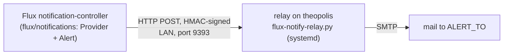

# Flux alerts: the second path

Prometheus alerts on Flux (`FluxObjectNotReady`; see [[Monitoring and alerts|paleotek kluster/monitoring and alerts]]), but Prometheus is itself deployed by Flux: a bad commit that breaks the monitoring stack silences the alert that would have told you. So Flux's own **notification-controller** posts every error event to a **relay on theopolis**, which mails it.

The relay is independent of the cluster, has its own SMTP login (copied from the watcher's env file), and the `notifications` Kustomization has **no `dependsOn`** on purpose, so a stuck CA or monitoring Kustomization cannot hold it back. Flux 2.9 has no email provider, hence the relay.

## How it is trusted

Flux signs each post (Provider `generic-hmac`, header `X-Signature: sha256=<HMAC of the body>`) with a shared token, and the relay refuses anything unsigned. The token is in git only as `flux/notifications/webhook-token.sops.yaml`, and on theopolis in `/etc/flux-notify-relay.env` (root, mode 600). The post is plain HTTP on the LAN and carries object names and error text, no secrets.

## Noise control

The relay mails the same (object, reason, message) once per 6 hours and at most 10 mails per hour. The Alert skips the "Dependencies do not meet ready condition" knock-on events. There is no "resolved" mail (Flux's error events only): look at `flux get all -A`.

## Set up (once)

1. Add `NOTIFY_URL=http://10.0.0.196:9393/` to `env.sh` and run `scripts/flux/01-cluster-vars.sh`.
2. `scripts/flux/05-webhook-token.sh` prints the token **once** and writes the encrypted Secret; commit the file.
3. On theopolis: `sudo WATCH_ENV=<the watcher's env file> LISTEN=<its address> scripts/theopolis/03-flux-notify-relay.sh`. It asks for the token and sends one test mail. Allow port 9393 from the node's address if the host has a firewall.

## Prove it

Commit a throwaway broken Kustomization (`path: ./does-not-exist`). Within a few minutes a mail `[flux] error Kustomization ...` arrives. Remove it again. If nothing arrives: `flux get alerts,providers -A` (both Ready?) and `journalctl -u flux-notify-relay` on theopolis. `bad or missing signature` means the two tokens differ: run `05` again, commit, and run `03` again with the new token.

## Rotate the token

Run `05` again, commit, then run `03` on theopolis with the new token. `scripts/theopolis/flux-notify-relay.py --selftest` is the relay's offline check; CI runs it.
