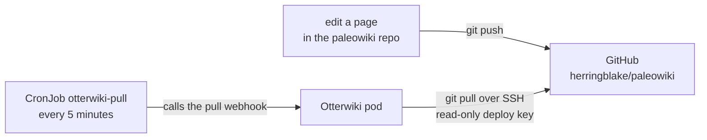

# Otterwiki (this wiki)

This wiki is [Otterwiki](https://otterwiki.com), a wiki whose pages are Markdown files in a git repository. It runs in the cluster at **https://wiki.intranet.home.arpa/** (LAN only, through the [[Intranet|paleotek kluster/intranet]] Gateway) and is deployed by Flux from `flux/apps/otterwiki`.

## Git is the only editor

The wiki's content lives in the GitHub repository **`herringblake/paleowiki`**. Nobody edits in the browser:

- Anyone on the LAN can **read**.
- **Writing and attachments are admin-only** (`WRITE_ACCESS=ADMIN`, `ATTACHMENT_ACCESS=ADMIN`), and **registration is closed** (`DISABLE_REGISTRATION`). There are no user accounts apart from one admin.
- A CronJob, `otterwiki-pull` in the `otterwiki` namespace, runs **every 5 minutes** and calls the wiki's pull webhook from inside the cluster. The wiki then runs `git pull` from GitHub over SSH, using a **read-only deploy key**.



### To publish or change a page

1. In a checkout of `paleowiki`, add or edit the Markdown file and push to `main`.
2. Within 5 minutes the page appears. Pages are lowercase file names; a page `foo.md` in a folder `bar/` is the wiki page `bar/foo`.
3. **Attachments** for `foo.md` go in a folder with the same name, `foo/`, and are referenced from the page as ``.
4. **Links between pages** use the wiki link form, `[[Title|folder/page name]]` (title first, then the page path). Do not use a `./` link for another page: it is resolved relative to the current page's own URL and will not find a sibling.
5. Mermaid diagrams work in fenced code blocks whose language is `mermaid`.

### Pull now

An admin can pull immediately: sign in, then **Administration, Repository Management, Pull**. Or trigger the webhook from inside the cluster (the CronJob does exactly this): `kubectl -n otterwiki create job --from=cronjob/otterwiki-pull pull-now`.

If the wiki and GitHub ever disagree, check `kubectl -n otterwiki get jobs`, the logs of the `otterwiki` pod (a successful pull logs "Already up to date" or the merge), and run `scripts/flux/verify-otterwiki.sh`, which compares the wiki's HEAD with GitHub's.

## How it is configured

All settings are environment variables on the Deployment (`flux/apps/otterwiki/deployment.yaml`), so Flux owns them and a rebuild reproduces them:

| Setting | Value |
|---|---|
| `READ_ACCESS` | `ANONYMOUS` |
| `WRITE_ACCESS`, `ATTACHMENT_ACCESS` | `ADMIN` |
| `DISABLE_REGISTRATION` | `True` |
| `GIT_REMOTE_PULL_ENABLED` | `True` |
| `GIT_REMOTE_PULL_URL` | the repository's SSH URL, from `WIKI_GIT_URL` in `env.sh` (not in git) |
| `GIT_REMOTE_PULL_PRIVATE_KEY_FILE` | the deploy key, mounted from the SOPS Secret `otterwiki-pull-key` (`pull-key.sops.yaml`) |

The look and feel (site name, logo, theme, sidebar, extra HTML) can be set the same way, as `SITE_NAME`, `SITE_LOGO`, `HTML_EXTRA_HEAD`, `HOME_PAGE`, `SIDEBAR_*` and so on, so the admin screens are never needed for it.

**Watch out:**
- **A setting saved in the admin UI overrides the environment variable** (the database wins). Do not save the Permissions or Repository Management pages there, or the wiki may drift from what git says.
- The pull is `git pull` (fetch and merge). An edit made in the admin UI would be a local commit and could break fast-forward pulls. **GitHub should be the only writer.**
- Otterwiki does not verify GitHub's SSH host key (it forces `StrictHostKeyChecking=no`). The deploy key is read-only, which limits the damage to injected content.
- A pull failure is silent: there is no SMTP configured, so Otterwiki cannot mail admins about it. `verify-otterwiki.sh` is how you notice.
- Mail is not configured at all, so there is no password-reset mail either.

## The admin account

There is one admin account (the one imported from the old Docker wiki). With no mail configured, a lost password is reset directly in the database, from the workstation, so the new password never appears on a command line:

```
read -rsp 'New admin password (min 8 chars): ' P; echo
kubectl -n otterwiki exec -i deploy/otterwiki -- env P="$P" python - <<'PY'
import os, sqlite3
from werkzeug.security import generate_password_hash
c = sqlite3.connect("/app-data/db.sqlite")
n = c.execute('update "user" set password_hash=? where id=1 and is_admin=1',
              (generate_password_hash(os.environ["P"], method="scrypt"),)).rowcount
c.commit(); print("updated", n)
PY
unset P
```

It should print `updated 1`. Keep the password in the password manager.

## Data and backups

The wiki's data is on the PersistentVolumeClaim `otterwiki-data` (2 Gi, `local-nvme`, `/app-data` in the pod): the SQLite database (the one admin user), `settings.cfg` (including the wiki's `SECRET_KEY`) and the git repository of pages. The namespace and the volume are annotated so Flux never prunes them.

- The volume is in the nightly backup bundle ([[Backups|paleotek kluster/backups]]); the pages are also in the GitHub repository.
- It was restored into a scratch PVC and a second pod once, with the same git HEAD and pages, and again in the replacement-host rehearsal (2 pages, 10 commits).
- Image: `redimp/otterwiki:2.26.0-slim`, pinned, running as uid 33 with a restricted pod security profile. `Recreate` rollout, because SQLite and the git repository allow one writer.

## History

The wiki first ran in Docker on a workstation with a locally mounted repository. It was moved into the cluster on 2026-10-24 with `scripts/otterwiki-import.sh` (a one-time copy of `/app-data`; it needs the `apps` Kustomization suspended, or Flux scales the wiki back up mid-copy). On 2026-10-28 it was switched to git-only editing with the timed pull described above, using the `paleowiki` repository seeded from the wiki's own repository (same 10 commits).
